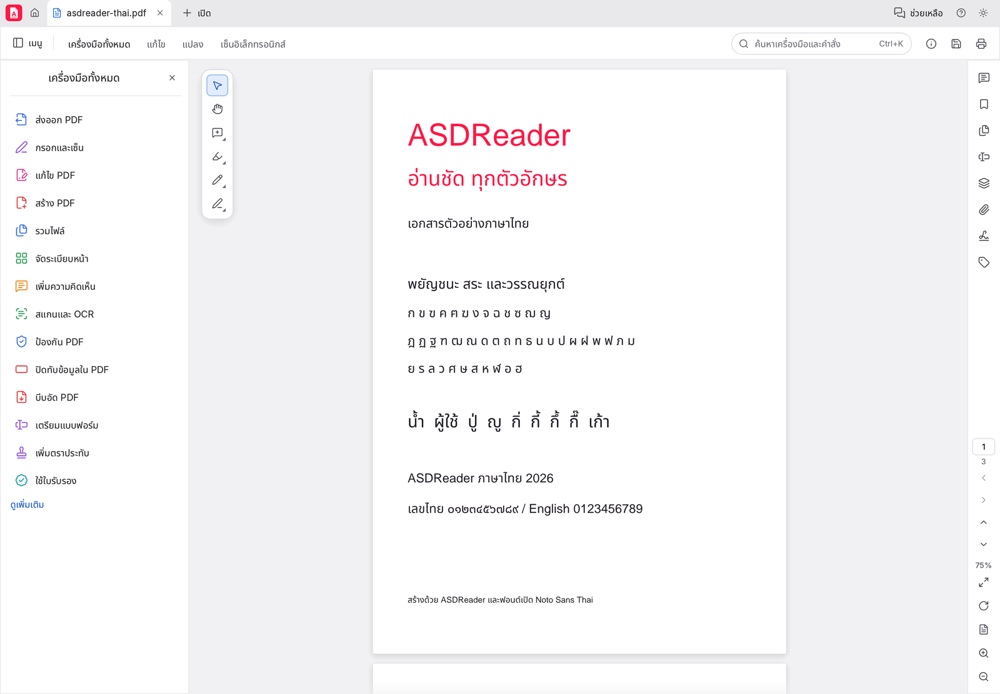

# ASDReader

โปรแกรมอ่านและแก้ไขไฟล์ PDF ที่ใช้งานภาษาไทยได้เต็มรูปแบบ ทั้งเมนูภาษาไทย การแก้ไขข้อความไทยในเอกสาร
การเลือกใช้ฟอนต์ที่ติดตั้งในเครื่อง และการพิมพ์ตามความละเอียดที่ตั้งไว้ในเครื่องพิมพ์

  <a class="card" href="download/"><strong>ดาวน์โหลดและติดตั้ง</strong>ตัวติดตั้ง Windows (เลือกโฟลเดอร์ติดตั้งได้), รุ่นพกพา และ Linux</a>
  <a class="card" href="manual/"><strong>คู่มือการใช้งาน</strong>เปิด อ่าน ค้นหา แก้ไขข้อความไทย กรอกฟอร์ม เซ็น จัดหน้า และพิมพ์</a>
  <a class="card" href="support/"><strong>ช่วยเหลือ</strong>คำถามที่พบบ่อย วิธีแก้ปัญหา และการแจ้งปัญหา</a>
  <a class="card" href="changelog/"><strong>มีอะไรใหม่</strong>รายการเปลี่ยนแปลงของแต่ละรุ่น</a>

## จุดเด่น

- **ภาษาไทยครบ** เมนูและข้อความในโปรแกรมเป็นภาษาไทย และใช้ฟอนต์ไทยแบบมีหัวที่ติดตั้งในเครื่อง (เช่น Tahoma, TH Sarabun) ถ้ามี
- **แก้ไขข้อความไทยในไฟล์ PDF** วรรณยุกต์และสระวางถูกตำแหน่ง รวมถึงไฟล์ที่ส่งออกจากโปรแกรมเขียนแบบ (CAD)
- **ใช้ฟอนต์ในเครื่องได้** เลือกฟอนต์ที่ติดตั้งในคอมพิวเตอร์มาใช้กับข้อความที่แก้ไข
- **พิมพ์ตามการตั้งค่าเครื่องพิมพ์** ความละเอียดและคุณภาพตามที่ตั้งไว้ใน Printing Preferences ของ Windows
- **ทำงานบนเครื่องของคุณ** ไม่อัปโหลดเอกสารไปที่ใด

## ความต้องการของระบบ

| ระบบ | รุ่นที่รองรับ |
|---|---|
| Windows | Windows 10 หรือใหม่กว่า, 64 บิต |
| Linux | x86_64 ที่มี glibc 2.35 ขึ้นไป |
