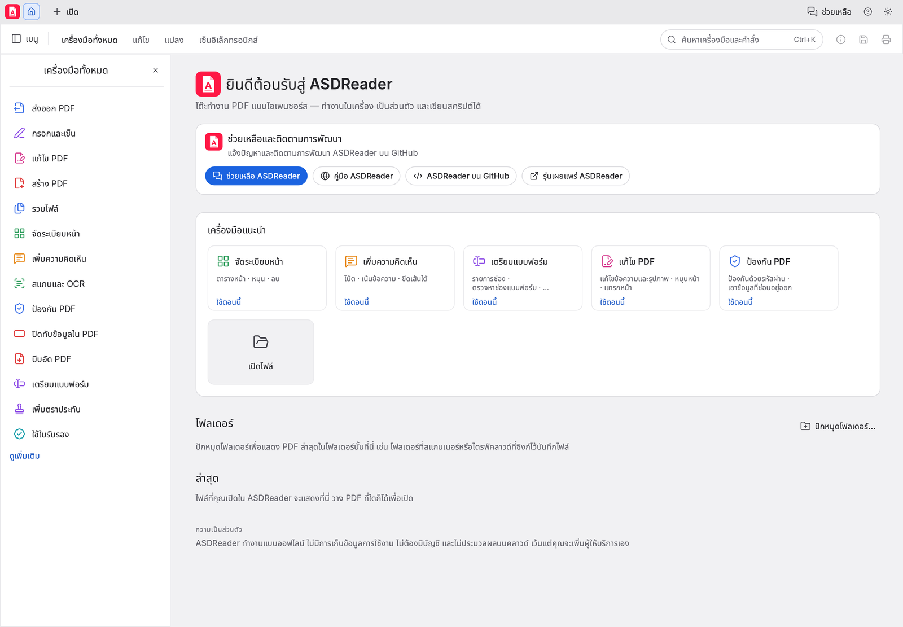
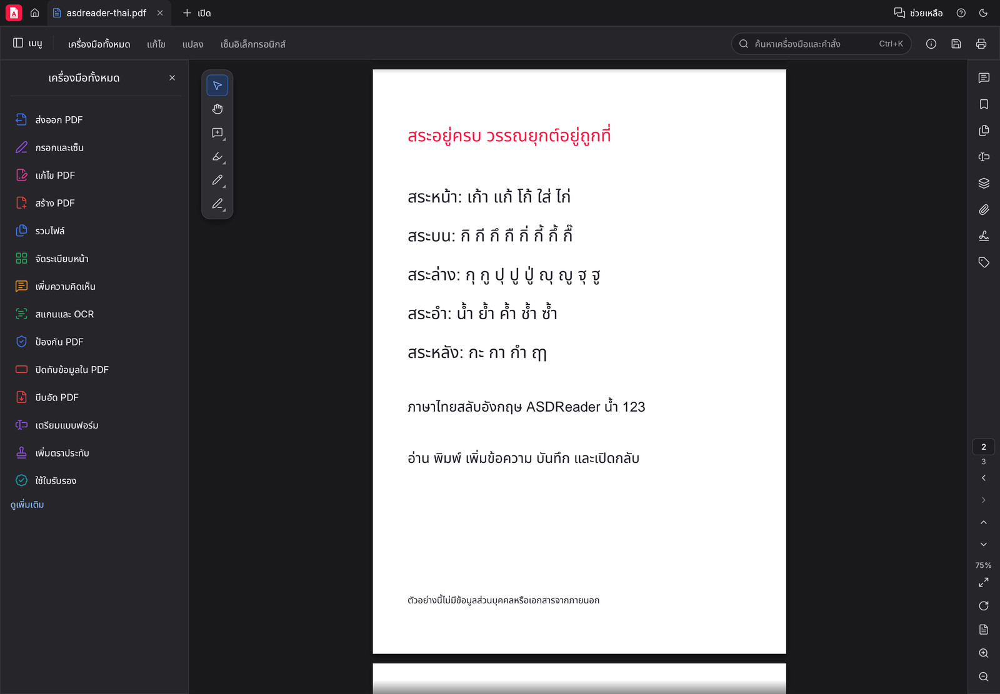

# คู่มือการใช้งาน

ชื่อเมนูและปุ่มในคู่มือนี้เป็นภาษาไทยตามที่แสดงในโปรแกรม ถ้าโปรแกรมของคุณแสดงเป็นภาษาอื่น
ดูวิธีเปลี่ยนภาษาที่ [ตั้งค่าโปรแกรม](#ตั้งค่าโปรแกรม)

**เนื้อหา**: [เริ่มต้นใช้งาน](#เริ่มต้นใช้งาน) ·
[อ่านและค้นหา](#อ่านและค้นหา) ·
[แก้ไขข้อความและรูปภาพ](#แก้ไขข้อความและรูปภาพ) ·
[ภาษาไทยและฟอนต์](#ภาษาไทยและฟอนต์) ·
[ความคิดเห็น](#ความคิดเห็น) ·
[กรอกและเซ็น](#กรอกและเซ็น) ·
[จัดระเบียบหน้า](#จัดระเบียบหน้า) ·
[สแกนและ OCR](#สแกนและ-ocr) ·
[พิมพ์](#พิมพ์) ·
[ASD PDF Printer](#asd-pdf-printer) ·
[ป้องกันและปิดทับข้อมูล](#ป้องกันและปิดทับข้อมูล) ·
[ตั้งค่าโปรแกรม](#ตั้งค่าโปรแกรม)

## เริ่มต้นใช้งาน



- **เปิดไฟล์**: กด **เปิด…** หรือลากไฟล์ PDF มาวางในหน้าต่างโปรแกรม ไฟล์ที่เคยเปิดจะแสดงที่หน้าแรก
- **เปิดหลายไฟล์**: แต่ละไฟล์เปิดเป็นแท็บของตัวเอง
- **บันทึก**: **บันทึก** เขียนทับไฟล์เดิม ส่วน **บันทึกเป็น…** บันทึกเป็นไฟล์ใหม่
- **เลิกทำ / ทำซ้ำ**: ย้อนการแก้ไขได้ทุกขั้นตอนก่อนปิดไฟล์
- **หาเครื่องมือ**: เปิด **เครื่องมือทั้งหมด** หรือพิมพ์ในช่อง **ค้นหาเครื่องมือและคำสั่ง…** เพื่อไปยังคำสั่งได้ทันที

ถ้าโปรแกรมปิดลงโดยไม่คาดคิด งานที่ยังไม่ได้บันทึกจะถูกเสนอให้กู้คืนเมื่อเปิดโปรแกรมครั้งถัดไป

## อ่านและค้นหา

- **ซูม**: ใช้ปุ่ม **ขยาย** / **ย่อ** หรือกด <kbd>Ctrl</kbd> พร้อมหมุนล้อเมาส์ เลือก **ขนาดจริง** หรือ **พอดี** ได้
- **หมุนหน้า** เพื่อดู: ใช้คำสั่ง **หมุน**
- **บุ๊กมาร์ก**: แผงด้านข้างแสดงสารบัญของเอกสาร คลิกเพื่อไปยังหัวข้อนั้น
- **ค้นหาข้อความ**: กด <kbd>Ctrl</kbd>+<kbd>F</kbd> หรือ **ค้นหา…** พิมพ์คำที่ต้องการ แล้วเลื่อนไปยังผลถัดไปหรือก่อนหน้า
  การค้นหาภาษาไทยรองรับไฟล์ที่ใช้ฟอนต์ไทยแบบเก่า (เช่น TH SarabunPSK, Cordia) ซึ่งเก็บวรรณยุกต์เป็นรหัสพิเศษ
- **คัดลอกข้อความ**: ลากเลือกข้อความแล้วกด <kbd>Ctrl</kbd>+<kbd>C</kbd>

## แก้ไขข้อความและรูปภาพ

1. เลือก **แก้ไข PDF** (หรือ **แก้ไขข้อความและรูปภาพ**)
2. คลิกในย่อหน้าที่ต้องการแก้ แล้วพิมพ์ได้ทันที ย่อหน้าจะตัดบรรทัดใหม่ตามความกว้างเดิม
3. คลิกนอกกล่องข้อความเพื่อยืนยันการแก้ไข หรือกด <kbd>Esc</kbd> เพื่อยกเลิก

แผง **จัดรูปแบบข้อความ** ด้านขวาใช้เปลี่ยน

- แบบอักษร ขนาด สี ตัวหนา ตัวเอียง ขีดเส้นใต้
- การจัดแนว ระยะบรรทัด ระยะตัวอักษร และความกว้างตัวอักษร

**เพิ่มข้อความใหม่**: เลือก **เพิ่มข้อความ** แล้วคลิกที่ตำแหน่งบนหน้า

**รูปภาพ**: ในโหมดแก้ไข คลิกรูปเพื่อย้าย ปรับขนาด หมุน ครอบตัด แทนที่ หรือลบ

## ภาษาไทยและฟอนต์



### เลือกฟอนต์ที่ติดตั้งในเครื่อง

ในแผง **จัดรูปแบบข้อความ** เปิดรายการแบบอักษร แล้วเลือก

- **คงแบบอักษรต้นฉบับ**: ใช้ฟอนต์เดิมของย่อหน้า
- ฟอนต์ที่มีอยู่แล้วในหน้านั้น
- **แบบอักษรที่ติดตั้ง…**: รายการฟอนต์ทั้งหมดในคอมพิวเตอร์ พิมพ์ในช่อง **ค้นหาแบบอักษร** เพื่อกรอง
  (รวมฟอนต์ที่อยู่ในไฟล์ `.ttc` เช่น Cordia New, Angsana New)
- **โหลดแบบอักษร…**: เลือกไฟล์ฟอนต์ `.ttf` หรือ `.otf` เอง

ฟอนต์ที่เลือกจะถูกฝังในไฟล์ PDF ทั้งไฟล์ เปิดไฟล์บนเครื่องอื่นได้โดยไม่ต้องติดตั้งฟอนต์ แต่ไฟล์จะใหญ่ขึ้น
ฟอนต์ที่ผู้ผลิตห้ามฝังลงเอกสารจะไม่แสดงในรายการ

### เมื่อพิมพ์ตัวอักษรที่ไฟล์ไม่มี

ไฟล์ PDF ส่วนใหญ่เก็บเฉพาะตัวอักษรที่เอกสารใช้ เมื่อคุณพิมพ์ตัวอักษรใหม่ (เช่น สระหรือวรรณยุกต์ที่เอกสารไม่เคยใช้)
ASDReader จะค้นหาฟอนต์ตัวเต็มชื่อเดียวกันที่ติดตั้งในเครื่อง (เช่น TH SarabunPSK) และใช้ให้อัตโนมัติ
ย่อหน้าจึงยังดูเหมือนเดิม ถ้าเครื่องไม่มีฟอนต์นั้น โปรแกรมจะแจ้งว่าตัวอักษรใดแสดงไม่ได้
ให้ติดตั้งฟอนต์นั้นก่อน หรือเลือกฟอนต์อื่นจาก **แบบอักษรที่ติดตั้ง…**

### ไฟล์จากโปรแกรมเขียนแบบ (CAD)

แบบบ้านหรือแบบก่อสร้างที่ส่งออกเป็น PDF มักวาดข้อความแบบหมุนบนหน้าแนวนอน ASDReader แก้ไขข้อความเหล่านี้ได้
และเลือกฟอนต์ให้ทั้งย่อหน้าได้ (ยังจัดรูปแบบเฉพาะบางส่วนของย่อหน้าที่หมุนไม่ได้)

## ความคิดเห็น

เลือก **ความคิดเห็น** แล้วใช้เครื่องมือ

- **เน้นข้อความ**: ลากผ่านข้อความที่ต้องการเน้น
- **โน้ต**: คลิกตำแหน่งที่ต้องการแปะโน้ต
- เส้น รูปทรง ข้อความ และตราประทับ

รายการความคิดเห็นทั้งหมดอยู่ในแผงความคิดเห็น ใช้ **ค้นหาความคิดเห็น** เพื่อกรอง

## กรอกและเซ็น

- **กรอกและเซ็น**: พิมพ์ลงในช่องของแบบฟอร์ม หรือวางข้อความ เครื่องหมาย และลายมือชื่อลงบนเอกสารใดก็ได้
- **เซ็น ▸ ใช้ใบรับรอง**: ลงลายมือชื่อดิจิทัลด้วยไฟล์ Digital ID (`.p12` / `.pfx`) ระบบตรวจสอบลายเซ็นในไฟล์ที่เปิดให้ด้วย
- **เตรียมแบบฟอร์ม**: สร้างหรือแก้ไขช่องกรอกข้อมูล

## จัดระเบียบหน้า

เลือก **จัดระเบียบหน้า** เพื่อดูภาพย่อของทุกหน้า แล้ว

- ลากเพื่อสลับลำดับ, **หมุน**, ลบ, **แทรก** หน้าจากไฟล์อื่น
- **แยกออกมา** เป็นไฟล์ใหม่ หรือ **แบ่ง** ไฟล์เป็นหลายไฟล์
- **รวมไฟล์**: รวม PDF หลายไฟล์เป็นไฟล์เดียว

เครื่องมืออื่นที่เกี่ยวข้อง: **ลายน้ำ**, หัวกระดาษและท้ายกระดาษ, **บีบอัด PDF**, **เปรียบเทียบไฟล์**

## สแกนและ OCR

เลือก **สแกนและ OCR ▸ รู้จำข้อความ** เพื่อแปลงภาพสแกนให้เป็นข้อความที่ค้นหาและคัดลอกได้
โปรแกรมทำงานบนเครื่องทั้งหมด ไม่ส่งไฟล์ออกไปภายนอก

## พิมพ์

กด <kbd>Ctrl</kbd>+<kbd>P</kbd> หรือ **พิมพ์…**

- เลือกเครื่องพิมพ์ จำนวนสำเนา หน้า และการพิมพ์ **สองด้าน**
- ขนาด: **พอดี**, **ขนาดจริง** หรือ **ย่อหน้าที่ใหญ่เกิน**
- หลายหน้าต่อแผ่น, **หนังสือเล่มเล็ก** หรือ **โปสเตอร์**
- **คุณสมบัติ…** เปิดหน้าตั้งค่าของเครื่องพิมพ์

<p class="note">บน Windows งานพิมพ์ใช้ค่าที่คุณตั้งไว้ใน <strong>Printing Preferences</strong> ของเครื่องพิมพ์ เช่น ความละเอียด (dpi)
คุณภาพการพิมพ์ ชนิดกระดาษ และถาดกระดาษ ส่วนตัวเลือกในหน้าต่างพิมพ์ของ ASDReader (จำนวนสำเนา สองด้าน สี ขนาดกระดาษ)
จะใช้แทนค่าเหล่านั้นเฉพาะงานนี้</p>

**พิมพ์เป็นรูปภาพ** (ในตัวเลือกขั้นสูง) ใช้กับไฟล์ที่พิมพ์ออกมาไม่ถูกต้อง โดยแปลงทุกหน้าเป็นภาพตามความละเอียดที่เลือกก่อนส่งพิมพ์

## ASD PDF Printer

ตัวติดตั้ง Windows เพิ่มเครื่องพิมพ์ชื่อ **ASD PDF Printer** ให้เลือกในรายการเครื่องพิมพ์ของทุกโปรแกรม
(Word, Excel, เบราว์เซอร์, โปรแกรมเขียนแบบ ฯลฯ) เมื่อสั่งพิมพ์ไปที่เครื่องนี้ ผลที่ได้คือไฟล์ PDF

- มีหน้าต่าง **บันทึก** ให้เลือกโฟลเดอร์และชื่อไฟล์ทุกครั้ง เริ่มที่โฟลเดอร์ล่าสุดที่เลือก (ครั้งแรกเป็น `เอกสาร`)
  ชื่อไฟล์ตั้งตามชื่อเอกสาร ถ้าไม่มีจะเป็น `Printed <วันที่ เวลา>.pdf` กด **ยกเลิก** เพื่อไม่บันทึกงานนั้น
- เปิดใน ASDReader ให้ทันทีหลังบันทึก
- **ข้อความไทยในไฟล์ถูกต้องครบ** รวมถึงไม้เอก ไม้โท สระอำ และสระบน-ล่าง ค้นหา คัดลอก และแก้ไขในโปรแกรมใดก็ได้

**ทำไมต้องซ่อม:** เครื่องพิมพ์ PDF มาตรฐานของ Windows ("Microsoft Print to PDF") วาดภาพหน้าถูกต้อง แต่เขียนข้อความที่ซ่อนอยู่
ในไฟล์ตกหล่น วรรณยุกต์ที่ฟอนต์เลือกรูปต่ำหรือเยื้องซ้ายไม่ถูกบันทึก "ที่ตั้ง" จึงถูกค้นหาและคัดลอกเป็น "ทีตัง"
ASD PDF Printer ซ่อมข้อความส่วนนี้จากฟอนต์ที่ฝังในไฟล์เองก่อนบันทึก

### ติดตั้งและใช้งาน

1. ตอนติดตั้ง ASDReader ที่หน้าแรกของตัวติดตั้ง ติ๊ก **Install the ASD PDF Printer** (เลือกไว้ให้แล้ว)
2. ในโปรแกรมใดก็ได้ เลือก **พิมพ์** แล้วเลือกเครื่องพิมพ์ **ASD PDF Printer**
3. เลือกที่เก็บและชื่อไฟล์ในหน้าต่างบันทึก แล้วกด **บันทึก** ไฟล์จะเปิดใน ASDReader

โปรแกรมรับงานพิมพ์ทำงานเบื้องหลังโดยไม่มีหน้าต่าง เริ่มเองเมื่อเข้าสู่ระบบ Windows และเมื่อเปิด ASDReader
ถ้าเพิ่งติดตั้งเสร็จ ให้เปิด ASDReader หนึ่งครั้งก่อนพิมพ์ครั้งแรก

### ติดตั้งแบบไม่มีหน้าจอ

```
msiexec /i asdreader-<รุ่น>-windows-x64.msi /qn INSTALLPDFPRINTER=0
```

`INSTALLPDFPRINTER=0` คือไม่ติดตั้ง ASD PDF Printer ถอนการติดตั้ง ASDReader จะลบเครื่องพิมพ์นี้ออกด้วย

### ใช้กับไฟล์ที่พิมพ์ด้วยเครื่องพิมพ์ PDF อื่น

ไฟล์ที่ได้จาก Microsoft Print to PDF และมีข้อความไทยตกหล่น ซ่อมได้ด้วยคำสั่งบรรทัดเดียว

```
asdreader-cli edit ไฟล์เดิม.pdf --repair-thai --full --out ไฟล์ที่ซ่อมแล้ว.pdf
```

### ข้อจำกัด

- ใช้ได้กับ Windows 10 ขึ้นไป
- รับงานพิมพ์ได้ทีละหนึ่งผู้ใช้ (ผู้ใช้ที่เข้าสู่ระบบก่อน) บนเครื่องที่ใช้หลายบัญชีพร้อมกัน
- รูปแบบหน้า ฟอนต์ และคุณภาพการพิมพ์เป็นของไดรเวอร์ของ Windows ส่วนที่ ASD PDF Printer ซ่อมคือข้อความที่ซ่อนอยู่ในไฟล์เท่านั้น

## ป้องกันและปิดทับข้อมูล

- **ป้องกัน**: ตั้งรหัสผ่านเปิดไฟล์ และจำกัดการพิมพ์หรือการแก้ไข
- **ปิดทับข้อมูล**: ลบข้อความหรือพื้นที่ออกจากไฟล์อย่างถาวร (ไม่ใช่แค่ทับด้วยสีดำ)
  ใช้ **ค้นหาข้อความแล้วปิดทับ…** เพื่อปิดทุกตำแหน่งของคำเดียวกันในครั้งเดียว

## ตั้งค่าโปรแกรม

เปิด **การตั้งค่า…**

- **ภาษาของโปรแกรม**: เลือก ภาษาไทย หรือภาษาอื่น
- **ธีม**: **สว่าง**, **มืด** หรือตามระบบ
- ขนาดหน้าจอโปรแกรม และค่าเริ่มต้นของการแก้ไขและการพิมพ์

ข้อความไทยในเมนูใช้ฟอนต์ไทยแบบมีหัวที่ติดตั้งในเครื่อง (Tahoma, TH Sarabun New ฯลฯ) ถ้ามี
